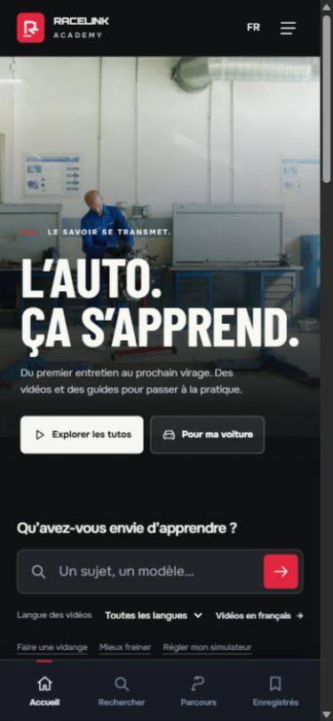
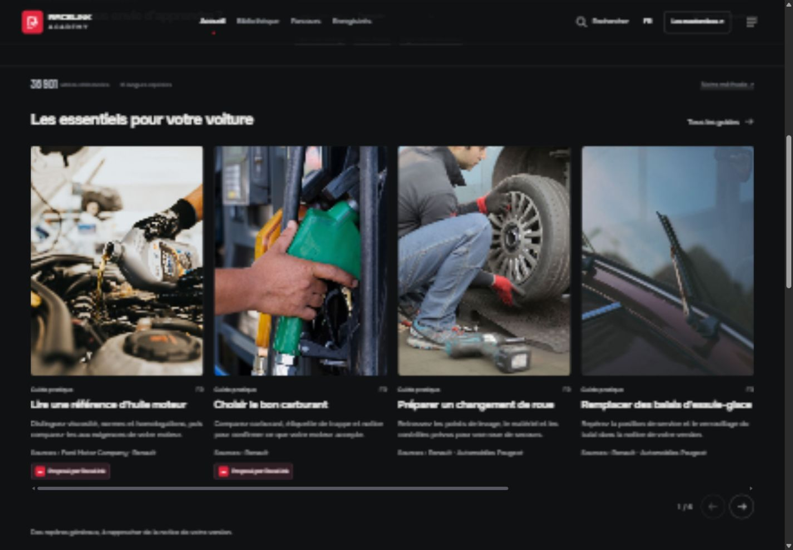
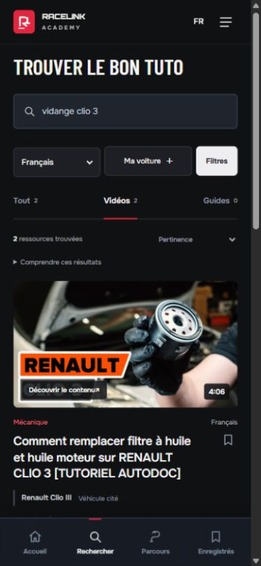

# Validation — Cinéma V21

Version **cinema-v21** publiée le 23 octobre 2026. [Ouvrir la version](https://valeriongg.github.io/racelink-academy/?release=cinema-v21&build=065ab48) · [Commit 065ab48](https://github.com/ValerionGG/racelink-academy/commit/065ab48e77faf6f6b1116c0d13f24d3b2b80b9b1) · [Déploiement réussi](https://github.com/ValerionGG/racelink-academy/actions/runs/40012783298).

## Résultat

L’accueil a une nouvelle composition : photographie d’atelier plein cadre, titre Barlow Condensed, entrée vers un guide réel, recherche puis collections. Six guides photographiques en 3:4, trois univers et jusqu’à12 vidéos éditoriales actives réutilisent les données existantes. Les résultats, filtres, lecteurs, parcours, menu et formulaire véhicule partagent une nouvelle couche visuelle sombre. L’ancien fichier produit V20 a été remplacé.

## Contrôles réalisés

- **109 contrats applicatifs** : navigation 17, HTML/bundle 14, export sur fixture 6, recherche/filtres 13, cartes 52, détail 7. [Rapport](validation-results.json).
- **20 contrats supplémentaires** du module d’accueil : données réelles, déduplication, langue, expiration, attributions et états indisponibles. [Rapport](home-checks.json).
- **27 scénarios et observations navigateur**, à 320, 390, 768, 1280 et 1440 px. [Détail par scénario](browser-checks.json).
- **18 fichiers publics** comparés au dépôt par HTTP ; archive compressée du catalogue identique au catalogue local. [Rapport HTTP](public-assets-check.json).
- **12 photos et 10 fichiers catalogue inchangés**, dont les transcriptions déjà présentes. Aucun nouveau contenu vidéo, texte ou procédure constructeur ajouté dans cette refonte. [Intégrité](catalogue-integrity.json).

La recherche « vidange clio 3 » avec langue française conserve la question et la langue, affiche deux résultats et un seul après filtre Tutoriel. Le véhicule Renault → Clio → III, les onglets de lecture, les vues aide/parcours/enregistrés et le retour clavier du guide ont été exercés.

## Corrections issues du rendu

Le hero mobile reste masqué dans les résultats. La hauteur du hero s’adapte aux traductions ; le raccourci français tient à côté du sélecteur à 390 px. Les onglets n’ont plus de scrollbar verticale. Le formulaire véhicule a des textes contrastés et son titre reste sous l’en-tête après ouverture. Les espacements entre phrases sont conservés quand les introductions reviennent à la ligne.

Les interactions ont été observées sur 7fbdbe6 puis les corrections sur 8d7f78a et 065ab48. Les scénarios finaux sont identifiés dans le JSON. Cela ne constitue pas un test sur appareil physique, un audit exhaustif d’accessibilité ou une validation de lecture de chaque vidéo externe. Aucun lecteur social ne s’est chargé automatiquement. Les sources constructeur existantes ont été préservées ; leurs pages externes n’ont pas fait l’objet d’une nouvelle vérification dans cette tâche.

## Captures

[Filtres](filters-mobile.png) · [Guide](guide-mobile.png) · [Lecteur vidéo](video-desktop.png) · [Sources constructeur](guide-sources-desktop.png) · [Véhicule](vehicle-mobile.png) · [Menu](menu-mobile.png) · [Parcours](paths-mobile.png).

## Références et brief

[Décisions visuelles](DESIGN-DECISIONS.md) : MasterClass, article officiel Netflix Tudum illustrant l’interface TV, catalogue Domestika. [Recherche de six ressources GitHub et prompt contraint](prompt-research.md). Agent Reach a servi par sa route GitHub/gh ; Exa, Flowith et MotionSite n’ont pas été utilisés de nouveau dans cette tâche. Les captures de références documentent la recherche et ne sont pas des médias de l’application.
