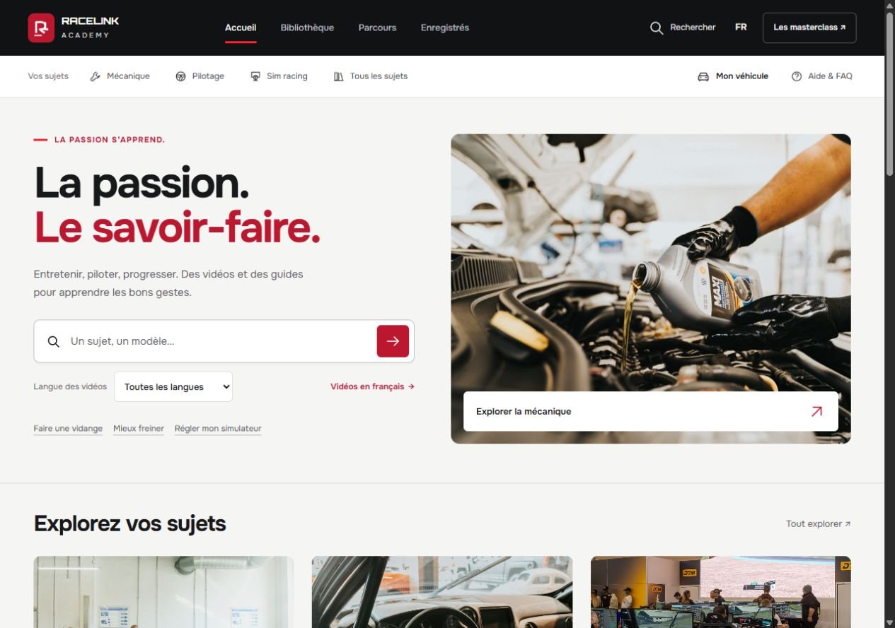
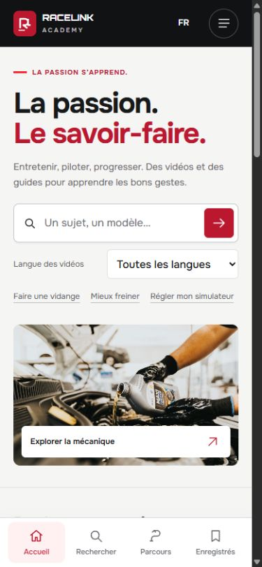

# Refonte graphique V19 — validation

Version **atelier-v19d**, [application publiée](https://valeriongg.github.io/racelink-academy/?release=atelier-v19d), commit [850e578](https://github.com/ValerionGG/racelink-academy/commit/850e57869e9ad9219c054000c8e7b46718835a25). [Déploiement réussi](https://github.com/ValerionGG/racelink-academy/actions/runs/39993178520). Vérification : 2026-10-23T17:15:18.864323+00:00.

## Ce qui change

L'accueil juxtapose une composition typographique claire et une photographie mécanique naturelle. La navigation horizontale libère la largeur utile. La recherche et la langue précèdent la photo sur téléphone. Les portes d'entrée utilisent de grandes photos ; la mise en avant des guides associe une autre photo et une action explicite.

La bibliothèque garde des couvertures 16:9, deux grandes colonnes à 1280 px et une colonne mobile. Les lecteurs de guides sont photographiques, avec méthode générale et notices constructeur distinctes. Les parcours sont des lignes éditoriales, avec intitulé, description et action, empilées sur mobile. Les menus passent à une liste lisible.

## Validation réalisée

- **17/17** contrats de navigation et libellés FR/EN/ES, sur V19c. V19d modifie uniquement deux règles CSS et les marqueurs de cache.
- **14/14** contrats HTML et correspondance exacte du bundle CSS, **6/6** exports sur données temporaires, relancés sur V19d.
- **15 fichiers publics** comparés au dépôt par HTTP ; catalogue compressé décompressé et comparé byte à byte.
- Navigateur public CUA : accueil desktop 1280, mobile 390, petit écran 320 et tablette 768. Aucun débordement horizontal du document dans les états mesurés. Versions, mesures et portée exacte dans [browser-checks.json](browser-checks.json).
- Recherche française « vidange Clio 3 », suggestions au clavier, ouverture/fermeture de fiche, langue conservée, filtre YouTube et retour du focus vérifiés pendant V19/V19b. Deux résultats pour la combinaison vérifiée. Les guides, leur accès aux notices et les nouveaux parcours ont été revérifiés sur V19c.
- V19d : menu 320 px recalé à l'origine, onglets au contenu complet sans dépassement interne, captures finales de l'accueil conservées.

## Corrections issues du navigateur

Le hero initialement encore visible au-dessus des résultats a été masqué par un sélecteur de spécificité correcte. Le placeholder mobile a été raccourci. Les petits défilements verticaux dans les onglets ont été retirés. Un lecteur ouvert bloque le défilement de l'arrière-plan. Le bouton de recherche tablette possède un nom accessible. Le menu mobile a perdu son décalage hérité de 12 px.

## Skills et références

Cette passe applique **Frontend Design**, **Impeccable**, **Hallmark** pour la critique et **Reference Design Contract** pour le cadrage. Les [douze ressources examinées en V18](../skills-roundup-2026-10-23/README.md) restent référencées avec leur rôle réel. La filiation visuelle RaceLink et MotionSite, ainsi que la consultation Flowith/Opus 5.5, proviennent des inspections V17 documentées ; aucune nouvelle génération Flowith n'est revendiquée ici. Aucun nouveau framework ou moteur d'animation n'est ajouté.

[DESIGN.md](../../DESIGN.md) et [PRODUCT.md](../../PRODUCT.md) décrivent la version réalisée. Le [contrat préparatoire](design-contract.md) conserve ses valeurs proposées ; DESIGN.md fait foi pour les valeurs effectives.

## Données et limites

**36 901 vidéos, 11 guides et 12 photos conservés.** Aucun nouvel import de vidéos, aucune nouvelle transcription ou preuve de compatibilité technique. SHA256 du catalogue : `083bc7f7e05382f189319e7e8e1a1050302d92606f16a6e0cda74212d023b544`. Les notices restent associées à leur modèle, moteur, période et périmètre ; la méthode RaceLink est distinguée d'une procédure constructeur.

Les mesures responsive ne remplacent ni un test sur téléphone physique, ni une revue exhaustive WCAG, lecteur d'écran ou zoom système. Le mouvement réduit est prévu dans le CSS, sans test du réglage système dans cette passe. La publication est sur GitHub Pages ; l'intégration au domaine Focus reste à réaliser. Le paquet local est synchronisé.

## Captures

[Bibliothèque mobile](mobile-guides-final.png) · [Lecteur](mobile-reader-final.png) · [Parcours ordinateur](desktop-paths-final.png) · [Parcours mobile](mobile-paths-final.png) · [Menu final 320 px](mobile-menu-final.png).

Les autres captures du dossier sont des étapes intermédiaires ; leur version est consignée dans browser-checks.json. `mobile-results.png` montre le défaut V19 corrigé, et ne constitue pas une validation finale.
