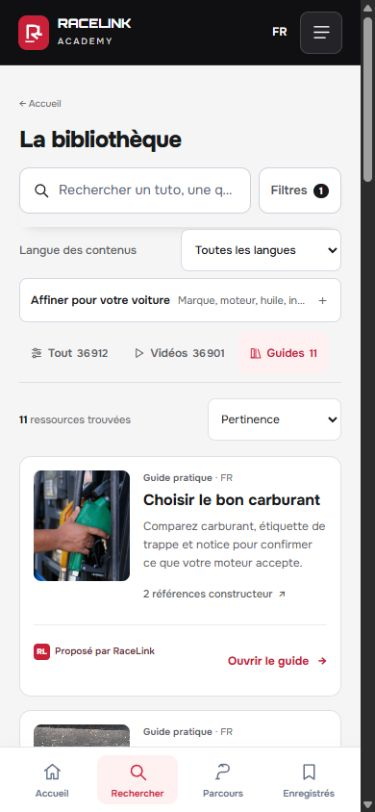
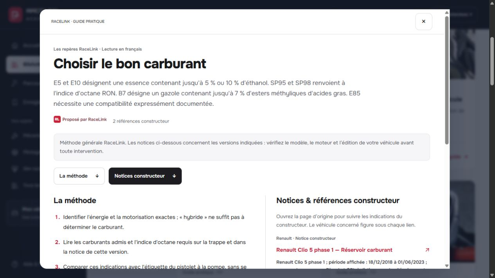

# Guides et sources constructeur — validation du 23 octobre 2026

Version **guide-v16b**, code [5e60fab](https://github.com/ValerionGG/racelink-academy/commit/5e60fab4c231976a15af0439c816cefc0dbce3d7), [publication réussie](https://github.com/ValerionGG/racelink-academy/actions/runs/39959821493). [Ouvrir les guides](https://valeriongg.github.io/racelink-academy/?browse=1&format=guide&release=guide-v16b).

## Résultat

La recherche mobile n’ajoute plus de couche fixe sous l’en-tête. Les guides utilisent des cartes photographiques compactes, avec un résumé court, l’accès direct aux références et un bouton d’ouverture. Le lecteur est commun aux résultats et à l’espace véhicule. Les crédits restent disponibles dans le lecteur et sur une page dédiée liée au pied de page.

Les 11 guides possèdent **21 références constructeur supplémentaires**, soit 45 liens documentaires au total. Les références directes montrent modèle, période, section, portée et date de consultation. Les portails et autres documents restent dans un groupe séparé. Les étapes RaceLink sont une méthode générale ; aucune compatibilité individuelle n’est déduite. Une page de niveau d’huile n’est pas présentée comme une procédure complète de vidange.

## Contrôles

- 14 contrats HTML et imports ; 16 scénarios de navigation simulée.
- 10 tests du rendu des sources : échappement, liens, catégories, dates et limites.
- 6 contrats de guides dont Worker et export, 4 régressions backend ciblées.
- 6 tests d’export statique ; 6 contrôles de badges et 7 de contenu social.
- Comparaison intégrale : les 36 901 fiches vidéo restent identiques. Les 11 guides changent, donc le catalogue global possède une nouvelle empreinte.
- 12 fichiers publics comparés au dépôt ; catalogue gzip décompressé identique au fichier publié. [Preuve HTTP](public-assets-check.json).

## Vérification visuelle

La v16 a été observée en mobile et à 320 px, puis la v16b finale sur ordinateur et à 390 px. Aucun débordement horizontal mesuré sur ces vues. La grille, le lecteur, le saut vers les références, la fermeture avec restauration du focus et une recherche vidéo française sont vérifiés. La v16b retire le filtre de format redondant et corrige le libellé véhicule découvert lors de l’essai.

[Détail par version](browser-checks.json) · [Décisions](DECISIONS.md) · [Sources A](sources-a.json) · [Sources B](sources-b.json).

Ces contrôles n’équivalent pas à un essai sur téléphone physique ni à un audit WCAG exhaustif. La recherche ne fabrique pas de suggestion quand aucune correspondance n’est trouvée avec les filtres actifs. Le domaine Focus original n’est pas modifié : la livraison reste une bibliothèque Pages et un paquet local à intégrer.
