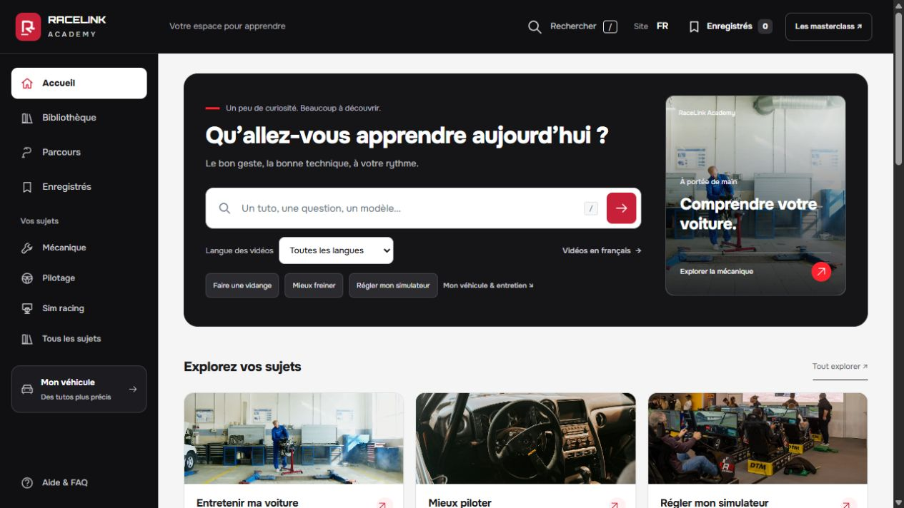
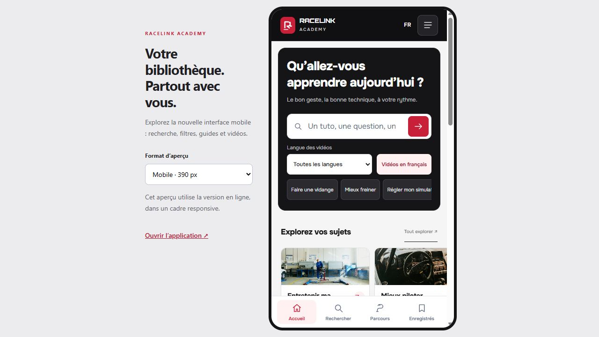

# Couvertures photographiques — photo-v15

Version publiée le 23 octobre 2026 : [ad0cc50](https://github.com/ValerionGG/racelink-academy/commit/ad0cc50). [Déploiement réussi](https://github.com/ValerionGG/racelink-academy/actions/runs/39938605756).

Les 11 guides et les trois entrées de découverte utilisent désormais 12 photographies réelles, hébergées avec le site. Les couvertures SVG décoratives et les gros pictogrammes des images d’accueil ont été retirés. Les titres restent hors image. Les icônes utiles à la navigation sont conservées.

Sources : Pexels, Unsplash et Wikimedia Commons ; auteur, page d’origine et licence sont conservés dans les registres publics et accessibles depuis les crédits. Les photographies illustrent un sujet, sans certifier une procédure ou une compatibilité. La photo VIN est documentaire et son numéro a été modifié par l’auteur. Un candidat « diagnostic » mal légendé par Pexels a été rejeté après inspection des pixels ; le visuel final montre un vrai connecteur OBD.

Les 12 JPEG représentent 1 450 046 octets. Tailles web fournies par les CDN, chargement différé des cartes, aucun filtre chromatique et aucune retouche générative. Les photographies sous CC BY-SA conservent leurs licences propres.

Contrôles réussis : 14 contrats HTML, 16 scénarios de navigation simulée, 6 tests d’export, 6 tests de badges et 7 vérifications de rendu social. La revue des guides ajoute 13 assertions hors navigateur. Les 25 fichiers publics contrôlés correspondent au dépôt. Le catalogue est strictement inchangé : 36 901 vidéos et 11 guides, même SHA-256 public.

Dans le navigateur public : accueil desktop et mobile 390 px inspectés ; première rangée des guides photographiques visible ; 11 guides présents dans l’arbre d’accessibilité ; ouverture et fermeture du guide carburant depuis sa photo avec retour du focus. Des blocages intermittents de l’outil navigateur ont empêché de terminer les essais de défilement et de lecture de guide en mobile. Aucun succès n’est attribué à ces tentatives, aucun audit mobile exhaustif ou essai sur téléphone physique n’est revendiqué.

[Détails navigateur](browser-checks.json) · [Contrôle des fichiers publiés](public-assets-check.json) · [Sources A](sources-a.json) · [Sources B](sources-b.json) · [Sources C](sources-c.json).

