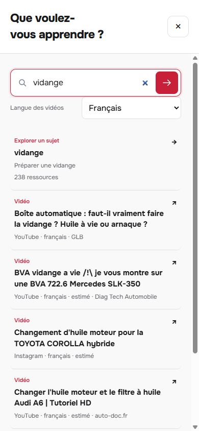

# Validation de la passe des douze ressources

Version **skills-v18c** publiée : [application](https://valeriongg.github.io/racelink-academy/?release=skills-v18c), [commit e0ee228](https://github.com/ValerionGG/racelink-academy/commit/e0ee2280f8af4bd84e10e3c246f2420b13588be8), [déploiement réussi](https://github.com/ValerionGG/racelink-academy/actions/runs/39985907291).

## Résultat et portée

La langue est visible dans la recherche mobile ; son changement conserve la saisie et les critères. Les suggestions présentent format, titre, plateforme, langue et auteur disponibles. Les grandes cartes ont des commandes natives et un retour de focus prévisible. Les onze guides sont accessibles depuis l'accueil, avec les références constructeur conservées.

Les douze ressources demandées ont été examinées. Quatre skills ont été ajoutés : Hallmark, Find Animation Opportunities, GSAP Performance et Reference Design Contract. La spécification Google enrichit le DESIGN.md existant. Les bibliothèques et workflows non exécutés sont identifiés dans [l'inventaire](README.md) ; aucune prétention d'avoir installé douze moteurs.

## Contrôles exécutés

| Contrôle | Résultat | Portée |
|---|---:|---|
| HTML et modules | 14 / 14 | Structure, identifiants, ARIA, imports et bundle CSS courant. [Rapport](html-contract-checks.json). |
| Navigation simulée | 17 / 17 | Modules et handlers de production, avec doubles DOM ; régression langue/saisie/feuille ouverte incluse. [Rapport](navigation-checks.json). |
| Export statique | 6 / 6 | Préfixes et intégrité de l'export. Une première exécution a rencontré un verrou de nettoyage Windows ; les exécutions suivantes ont réussi. |
| Backend | 45 / 45 | Suggestions et métadonnées ; données absentes laissées absentes. |
| Worker | 40 contrôles réussis | Contrats du catalogue et métadonnées de suggestions. |
| Parité API / Worker | 76 comparaisons | 31 recherches, 4 options véhicule, 24 contrôles découverte/suggestions et 17 recherches de ressources. [Rapport](suggestion-metadata-parity.json). |
| Publication HTTP | 18 fichiers identiques | Comparaison des fichiers servis avec le commit, plus catalogue compressé intégral. [Rapport](public-assets-check.json). |

Les tests backend/Worker et la parité ont été exécutés par l'agent chargé de ces fichiers. HTML, navigation, export, HTTP et navigateur ont été exécutés par l'agent principal. Les tests historiques de collecte ne sont pas présentés comme réexécutés pendant cette passe.

## Navigateur réellement utilisé

Navigateur intégré Codex, largeur de viewport simulée. Les interactions ont été vérifiées sur **V18b** ; V18c ne change que l'alignement des types de suggestion et les marqueurs de cache. Les vues essentielles ont ensuite été recapturées et contrôlées sur **V18c**. [Observations DOM](browser-checks.json).

- **390 × 844 :** saisir « vidange », sélectionner Français sans fermer la recherche ; six suggestions correspondant au filtre, avec statuts de langue conservés. Titres 15 px, types 11 px et compléments 12 px constatés.
- **Clavier :** flèches puis Entrée ouvrent une vidéo ; fermeture rend le focus à Modifier la recherche et ne rouvre pas la feuille. Le lecteur s'est ouvert ; aucune lecture intégrale de la vidéo n'est revendiquée.
- **Rails :** navigation vers les deuxième et troisième cartes, état final `3 / 3`, bouton suivant `aria-disabled=true` mais focus conservé. Tab mène au crédit photo. Un état intermédiaire enregistré avant la fin du scroll est distingué de l'état final stabilisé.
- **Changement vers 1280 × 900 :** contrôles de rails masqués quand toutes les cartes tiennent, focus rendu à une carte visible ; pas de débordement horizontal. Trois photos de sujets chargées, environ 310 × 194 px ; métadonnées éditoriales à 12 px.
- **Guides :** bouton d'accueil ouvre onze guides. L'accès aux références du guide carburant ouvre le lecteur et place le focus sur les sources ; liens et périmètres Renault visibles. Les pages constructeur n'ont pas été intégralement revérifiées pendant cette passe.
- **320 × 740 :** interface espagnole et vidéos françaises indépendantes ; recherche « vidange Clio 3 » conservée, deux vidéos proposées avec le sujet. Aucun débordement horizontal du document ou du dialogue. Types alignés à gauche sur V18c.

Le mouvement réduit est traité dans le CSS et dans le choix de scroll instantané du module de rail ; il n'a pas été simulé par une préférence système pendant ce contrôle. Aucun test sur téléphone physique, clavier logiciel iOS/Android, lecteur d'écran, texte agrandi ou audit WCAG complet n'est revendiqué.

## Captures

[Recherche avant](search-before.png) · [Recherche française finale](search-french-mobile-final.png) · [Recherche finale à 320 px](search-320-final.png) · [Découverte photographique mobile](mobile-discovery-final.png) · [Accueil desktop](desktop-home-final.png) · [Guides mobiles V18b](mobile-guides.png).

## Données et livraison

Catalogue inchangé : **36 901 vidéos**, **11 guides**, **21 références constructeur ajoutées lors de V16**, et les autres sources documentaires conservées. SHA-256 du catalogue décompressé : `083bc7f7e05382f189319e7e8e1a1050302d92606f16a6e0cda74212d023b544`.

La page est publiée sur GitHub Pages. L'intégration dans le domaine Focus n'a pas été effectuée. Le paquet local et son manifeste sont régénérés après ces vérifications. Les rapports techniques et les captures distinguent les propositions des agents des changements finalement livrés.

Les audits statiques Hallmark/Taste ont des alertes de conventions documentées dans [group-ui.md](group-ui.md). Ils ne sont pas présentés comme une certification zéro défaut. La correction de focus signalée par la revue indépendante a été implémentée et vérifiée au navigateur.
