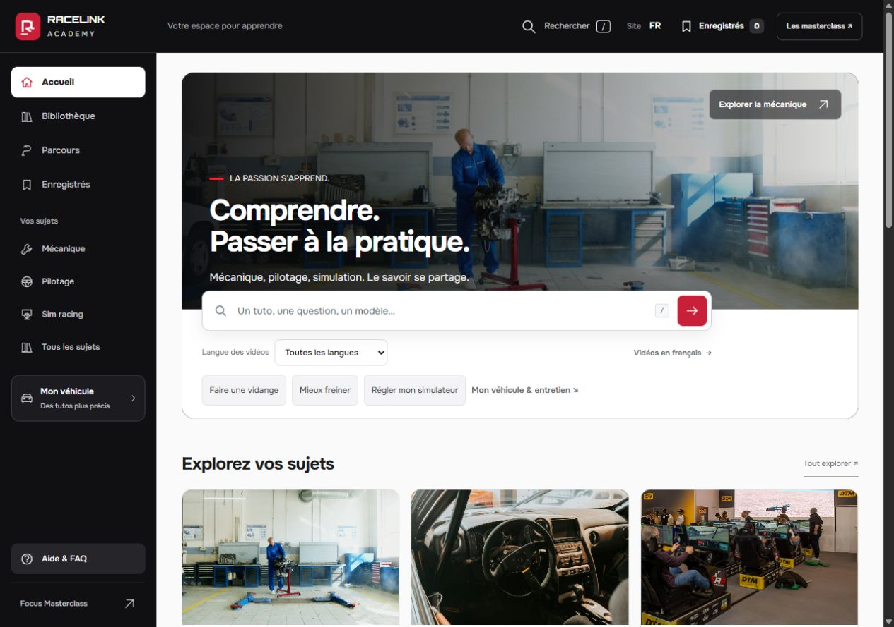
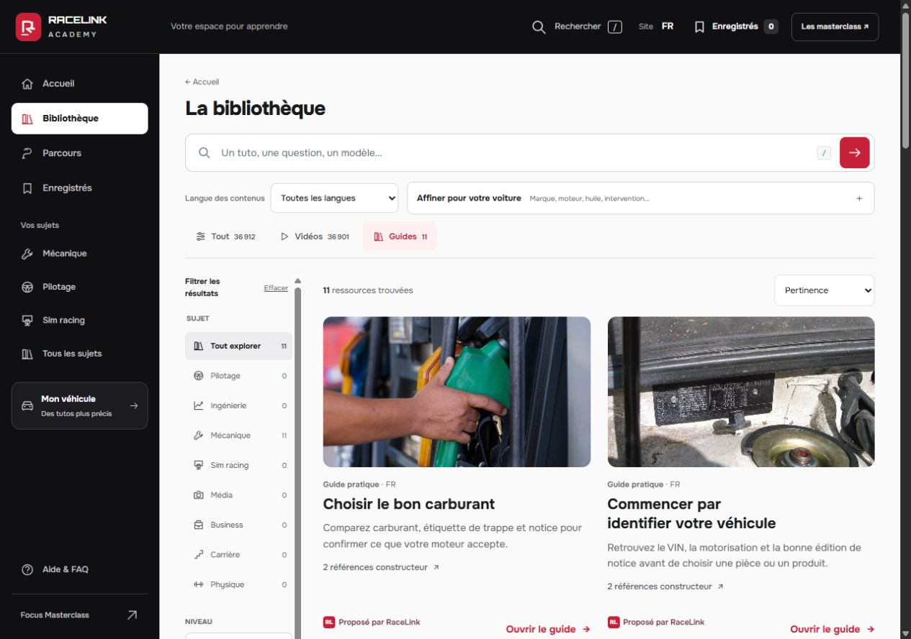
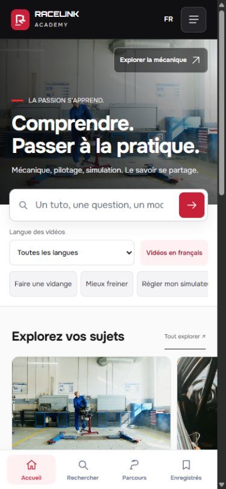
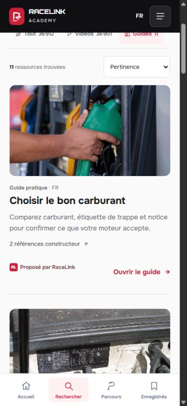

# Validation — bibliothèque photographique V17

**Publication vérifiée : visual-v17c**, commit [9b7dbfc](https://github.com/ValerionGG/racelink-academy/commit/9b7dbfcd6ca2924149220eac772e5f9e8fb5cc06). [Déploiement réussi](https://github.com/ValerionGG/racelink-academy/actions/runs/39964526060).

## Ce qui a changé

- Les guides retrouvent une photographie 16:9 sur toute la largeur de leur carte ; les vidéos suivent ce même principe. Les petites images latérales mobiles sont retirées.
- Titres lisibles de 20–21 px, descriptions courtes, accès aux références constructeur et action de lecture distincts. Les titres techniques de vidéos peuvent occuper les lignes nécessaires.
- Accueil avec une vraie photo mécanique dominante, texte court et recherche à la jonction ; catégories photographiques agrandies. Couleurs RaceLink, fond de lecture clair.
- Au catalogue mobile, suppression du lien Accueil redondant avec la navigation basse ; le compteur Filtres ne recompte plus le format déjà visible dans les onglets.
- CSS de présentation remplacée dans le composant existant, sans ajouter un nouveau fichier de surcharges.

Les 36 901 vidéos, 11 guides, 12 photos créditées et 45 liens documentaires sont conservés. Parmi ces liens, 21 références constructeur documentées ont été ajoutées lors de V16 : aucune nouvelle référence technique n’est revendiquée par cette retouche visuelle.

## Références effectivement employées

Les aperçus publics de [Driven Hero](https://www.motionsite.ai/sections/driven-hero) et [Hyperion V12](https://www.motionsite.ai/templates/hyperion-v12) ont été ouverts et inspectés visuellement sur MotionSite, ainsi que [RaceLink](https://racelink-app.co/). Les captures sont dans ce dossier. La transposition concerne la place de la photographie, le contraste, la hiérarchie et le rouge de marque ; aucun code premium ni animation 3D n’a été récupéré.

Une contre-proposition a été réellement demandée à **Claude Opus 5.5 dans Flowith**, puis adaptée dans le code. [Brief, réponse et limites](flowith-opus-5-5.md). La variante A a été retenue avec fonds de lecture clairs et dimensions recalculées pour la sidebar. La proposition B est textuelle ; deux prototypes visuels complets n’ont pas été produits.

[Design contract](design-contract.md) · [Comparaison des moteurs](design-engines.md) · [Références complémentaires et niveaux de preuve](visual-references.md) · [6 skills GitHub comparés](skills-research.md). Taste et UI UX Pro Max ont été installés aux SHA audités, sans lancer leurs scripts. Design Inspiration, Impeccable et Frontend Design ont guidé la recherche et l’implémentation. Les directives pertinentes de Taste et UI UX Pro Max ont servi de contrelecture ; aucun moteur de thème aléatoire n’a été exécuté.

## Vérifications

- **14 contrats HTML** et **6 tests d’export** passent sur les sources finales V17c. **16 contrôles de navigation simulée** ont passé sur V17 et V17b ; V17c ne change ensuite que le CSS à 320 px et les marqueurs de cache.
- **15 fichiers publics** correspondent aux fichiers du dépôt, après normalisation des fins de ligne. Le catalogue compressé se décompresse vers les mêmes octets que V16 : SHA256 `083bc7f7e05382f189319e7e8e1a1050302d92606f16a6e0cda74212d023b544`.
- Navigateur public CUA : accueil desktop à 1280 px, grands guides sur deux colonnes ; tablette 768 px avec une colonne de résultats dans la largeur restante ; mobile 390 px avec photos sur toute la largeur des cartes.
- À 320 px, accueil FR/EN/ES sans débordement horizontal mesuré, recherche entièrement visible (bas du champ à 382 px). Photo de l’accueil sur la largeur utile de 305 px ; la barre de défilement de l’environnement utilise 15 px.
- Suggestions pour « vidange » : sujet, guide et vidéos affichés ; champ et liste lisibles à 320 px.
- Sur V17b : requête « vidange Clio 3 », format vidéo et langue française → **2 résultats**, couvertures de 273 px dans le petit écran. Accès direct aux références du guide carburant, véhicule et période visibles ; fermeture avec focus restauré sur le bouton d’origine. La logique reste identique dans V17c.
- Contrelecture indépendante des quatre captures finales : pas de défaut visuel bloquant observé. Cette appréciation ne garantit pas une préférence esthétique de l’utilisateur.

[Mesures navigateur](browser-checks.json) · [Vérification HTTP](public-assets-check.json). Les photos différées hors écran ne sont pas considérées défectueuses parce qu’elles ne sont pas encore chargées.

## Captures finales

## Périmètre

Vérifications par navigateur responsive, pas sur téléphone physique et pas un audit WCAG exhaustif. Les vidéos sources ne sont pas visionnées à nouveau. Les droits et attributions photographiques restent ceux du dossier photo-covers-2026-10-23. La version est publiée sur GitHub Pages ; l’intégration au domaine Focus original reste fournie sous forme de paquet.
